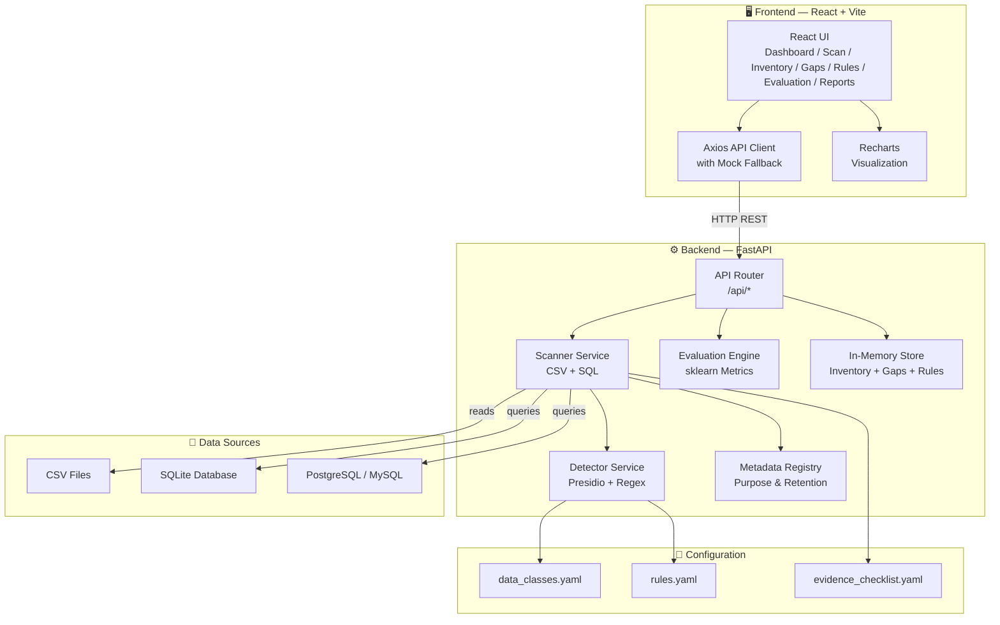
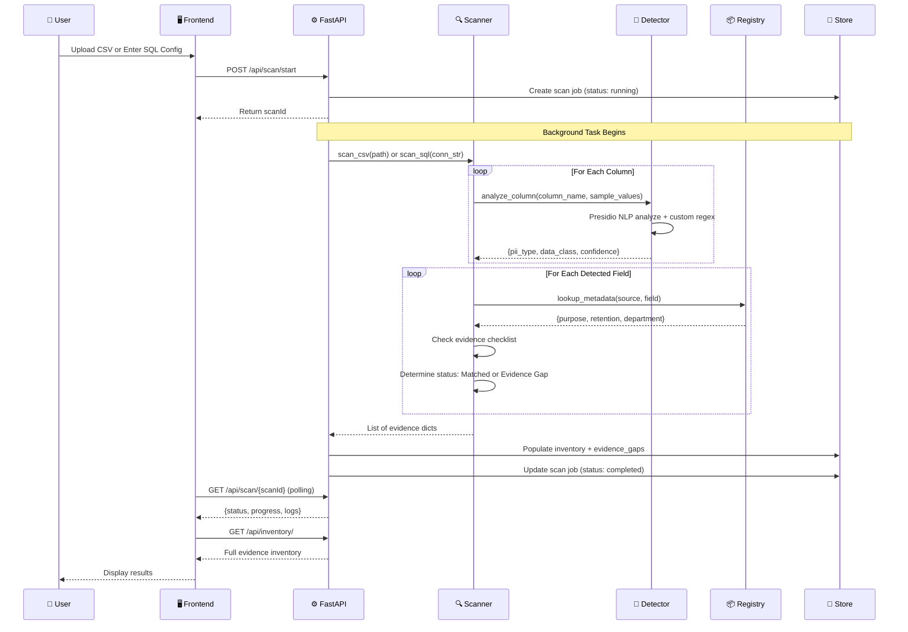
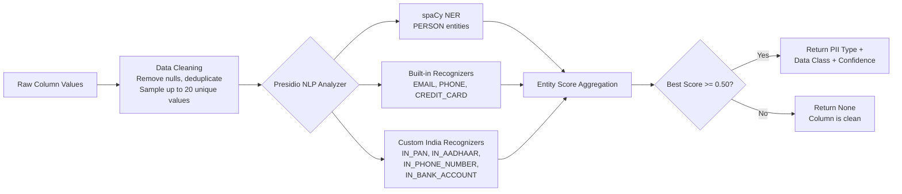
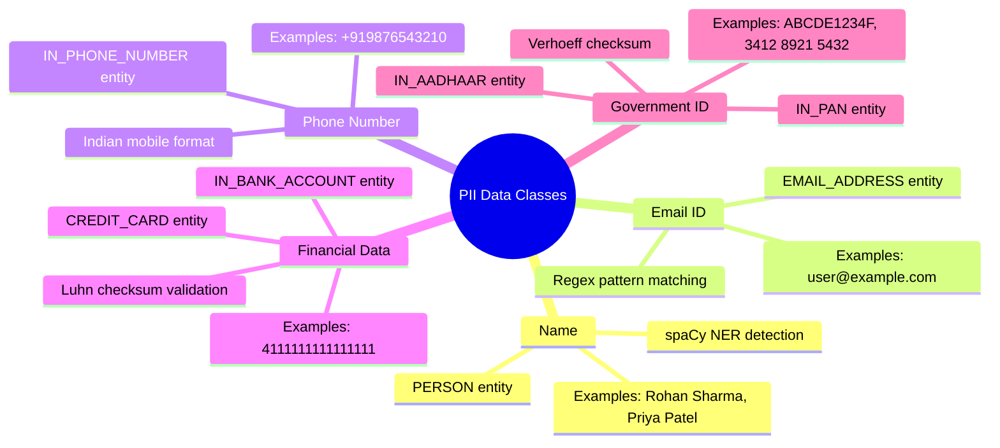
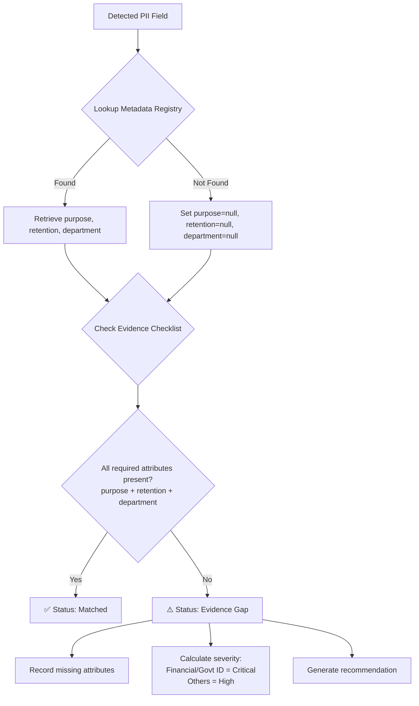
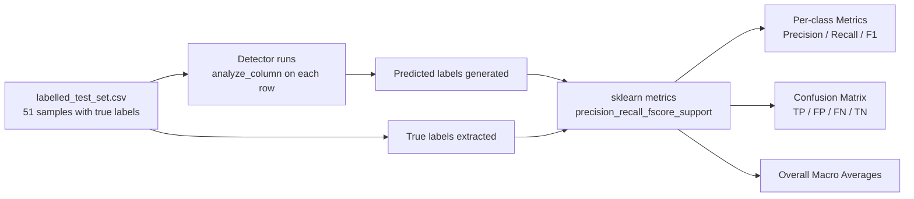
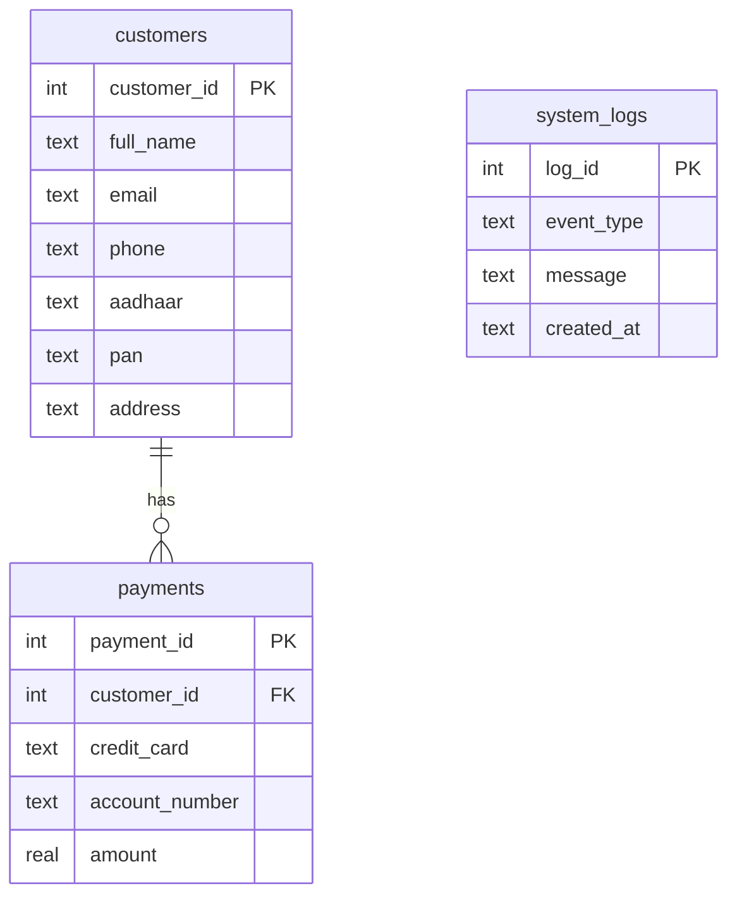

<p align="center">
  
  
</p>

<h1 align="center">🛡️ PriVista</h1>
<h3 align="center"><em>Personal-Data Discovery & Privacy Evidence Inventory</em></h3>

<p align="center">
  An intelligent scanner that discovers Personally Identifiable Information (PII) across CSV files and SQL databases, links each discovered field to declared business purposes and retention schedules, and produces a structured evidence inventory for human review — flagging every gap where metadata is missing.
</p>
<div align="center">

[](https://reactjs.org/)
[](https://fastapi.tiangolo.com/)
[](https://python.org/)
[](https://microsoft.github.io/presidio/)
[](https://tailwindcss.com/)
[](#)

</div>

---
**Watch the complete walkthrough of PriVista on youtube: https://youtu.be/I59mDbrqpyo**

## 📑 Table of Contents

| # | Section |
|---|---------|
| 1 | [Problem Statement](#-problem-statement) |
| 2 | [Our Solution — PriVista](#-our-solution--privista) |
| 3 | [Key Features](#-key-features) |
| 4 | [System Architecture](#-system-architecture) |
| 5 | [Tech Stack](#-tech-stack) |
| 6 | [Project Structure](#-project-structure) |
| 7 | [Core Workflow — How a Scan Works](#-core-workflow--how-a-scan-works) |
| 8 | [Detection Pipeline — Deep Dive](#-detection-pipeline--deep-dive) |
| 9 | [The 5 PII Data Classes](#-the-5-pii-data-classes) |
| 10 | [Evidence Inventory & Gap Analysis](#-evidence-inventory--gap-analysis) |
| 11 | [Evaluation Engine](#-evaluation-engine) |
| 12 | [Configurable Detection Rules](#-configurable-detection-rules) |
| 13 | [API Reference](#-api-reference) |
| 14 | [Frontend Pages](#-frontend-pages) |
| 15 | [Getting Started](#-getting-started) |
| 16 | [Data Files & Seed Scripts](#-data-files--seed-scripts) |

---

## 🔍 Problem Statement

> **PS-019 · Personal-Data Discovery and Privacy Evidence Inventory**
> *(Category: Cybersecurity — AIORI-3)*

Modern data-protection frameworks require organizations to **identify stored Personally Identifiable Information (PII)** and link it to **declared purposes and retention schedules**. Over time, personal-data fields accumulate across unindexed database tables and spreadsheets without clear documentation.

### The Challenge

Build a tool that:

1. **Identifies** candidate personal-data fields in synthetic structured datasets (CSV + SQL).
2. **Connects** them with declared purposes and retention metadata.
3. **Creates** a privacy evidence inventory for human review — *without* making legal compliance decisions.

### Key Requirements

| # | Requirement | How PriVista Addresses It |
|---|-------------|--------------------------|
| 1 | Support CSV and one SQL database | ✅ CSV upload + SQLite / PostgreSQL / MySQL scanning |
| 2 | Identify 5 predefined data classes | ✅ Name, Email, Phone, Financial, Government ID |
| 3 | Use a small manually labelled test set for evaluation | ✅ `labelled_test_set.csv` with 51 labelled samples |
| 4 | Detect candidate personal-data fields using configurable rules | ✅ YAML-driven rules + Presidio NLP + custom regex |
| 5 | Link discovered fields to purpose and retention metadata | ✅ Metadata Registry with automated lookups |
| 6 | Flag missing purpose or retention information | ✅ Evidence Gap tracker with severity ratings |
| 7 | Report per-class precision and recall | ✅ Evaluation engine with sklearn metrics |
| 8 | Clearly distinguish technical evidence from legal interpretation | ✅ Reports labelled as "Technical Evidence" only |
| 9 | No automatic lawful-basis determination or universal data-flow inference | ✅ System produces evidence for human review only |

### Expected Outcomes Delivered

- ✅ **Personal-data discovery scanner** — scans CSV files and SQL databases
- ✅ **Structured data inventory** — browsable, searchable evidence table
- ✅ **Configurable evidence checklist** — `evidence_checklist.yaml` (purpose, retention, department)
- ✅ **Purpose and retention metadata mapping** — automatic via Metadata Registry
- ✅ **Per-class precision/recall evaluation** — built-in evaluation page
- ✅ **Missing-metadata and evidence gap report** — dedicated Evidence Gaps view
- ✅ **Final technical report and demonstration** — downloadable JSON reports

---

## 💡 Our Solution — PriVista

**PriVista** (_Privacy + Vista_) is a full-stack web application that automates personal-data discovery and produces a structured privacy evidence inventory.

```
┌───────────────────────────────────────────────────────────────────────┐
│                                                                       │
│   📄 CSV Files   ──┐                                                  │
│                     ├──►  🤖 PII Detection Engine  ──►  📋 Evidence   │
│   🗄️ SQL Database ──┘     (Presidio NLP + Regex)       Inventory     │
│                                                            │          │
│                                                            ▼          │
│                                                    ┌──────────────┐   │
│                                                    │  ✅ Matched   │   │
│                                                    │  ⚠️ Gaps      │   │
│                                                    │  📊 Reports   │   │
│                                                    └──────────────┘   │
│                                                                       │
└───────────────────────────────────────────────────────────────────────┘
```

The system **does not** make legal compliance decisions — it produces **technical evidence** for human reviewers to evaluate.

---

## ✨ Key Features

| Feature | Description |
|---------|-------------|
| **🔎 Multi-Source Scanning** | Upload CSV files or connect directly to SQLite, PostgreSQL, or MySQL databases |
| **🤖 NLP + Regex Detection** | Microsoft Presidio NLP engine with spaCy NER models, enhanced by custom India-specific regex patterns |
| **📦 5 PII Data Classes** | Name, Email ID, Phone Number, Financial Data, Government ID |
| **📋 Evidence Inventory** | Structured, searchable table of every discovered PII field with metadata |
| **⚠️ Gap Analysis** | Automatically flags fields missing purpose, retention, or owner metadata |
| **⚙️ Configurable Rules** | YAML-driven detection rules with live toggle and real-time test console |
| **📊 Evaluation Metrics** | Per-class precision, recall, F1-score with confusion matrix visualization |
| **📥 Downloadable Reports** | Export evidence inventory, gap register, and rule config as JSON |
| **🎨 Modern Dashboard** | Real-time charts, trend analysis, and compliance score overview |

---

## 🏗️ System Architecture



### Layered Architecture Overview

```
┌─────────────────────────────────────────────────────┐
│               PRESENTATION LAYER                     │
│   React 19 + Vite 8 + TailwindCSS 4 + Recharts     │
│   Pages: Dashboard │ Scan │ Inventory │ Gaps │      │
│          Rules │ Evaluation │ Reports                │
├─────────────────────────────────────────────────────┤
│                  API LAYER                           │
│   Axios HTTP Client ←──REST──→ FastAPI Router       │
│   Mock Fallback Mode for Offline Development         │
├─────────────────────────────────────────────────────┤
│               SERVICE LAYER                          │
│   Scanner → Detector → Registry → Evaluator         │
│   Background Scan Jobs with Progress Tracking        │
├─────────────────────────────────────────────────────┤
│            CONFIGURATION LAYER                       │
│   data_classes.yaml │ rules.yaml │ checklist.yaml   │
├─────────────────────────────────────────────────────┤
│                DATA LAYER                            │
│   CSV Files │ SQLite │ PostgreSQL │ MySQL            │
│   In-Memory Store (Inventory, Gaps, Rules, Reports) │
└─────────────────────────────────────────────────────┘
```

---

## 🛠️ Tech Stack

### Backend

| Technology | Version | Purpose |
|------------|---------|---------|
| **Python** | 3.10+ | Core backend language |
| **FastAPI** | Latest | Async REST API framework with auto-generated OpenAPI docs |
| **Uvicorn** | Latest | ASGI server for running FastAPI |
| **Microsoft Presidio** | Latest | NLP-powered PII detection engine |
| **spaCy** (`en_core_web_lg`) | Latest | Named Entity Recognition (NER) model for detecting names, orgs, etc. |
| **SQLAlchemy** | Latest | SQL database ORM — connection, introspection, and querying |
| **Pandas** | Latest | CSV parsing and tabular data manipulation |
| **scikit-learn** | Latest | Precision, recall, F1 computation for evaluation metrics |
| **NumPy** | Latest | Numerical operations for metric calculations |
| **PyYAML** | Latest | YAML configuration file parsing |
| **Pydantic** | Latest | Request/response schema validation |
| **Faker** | Latest | Synthetic test-data generation (Indian locale) |

### Frontend

| Technology | Version | Purpose |
|------------|---------|---------|
| **React** | 19.2 | Component-based UI framework |
| **Vite** | 8.3 | Lightning-fast dev server and build tool |
| **TailwindCSS** | 4.3 | Utility-first CSS framework |
| **React Router DOM** | 7.18 | Client-side routing and navigation |
| **Axios** | 1.20 | HTTP client for API communication |
| **Recharts** | 3.10 | Charting library for pie charts, line charts, bar charts |
| **Lucide React** | 1.59 | Modern icon library |
| **OxLint** | 1.81 | Fast JavaScript linter |

### Data Storage & Formats

| Component | Technology |
|-----------|------------|
| **Primary SQL Database** | SQLite (bundled `sample.db`) |
| **External Database Support** | PostgreSQL, MySQL |
| **File Input** | CSV (`.csv`) |
| **Configuration** | YAML (`.yaml`) |
| **Test Data** | Manually labelled CSV (`labelled_test_set.csv`) |
| **Reports** | JSON export |

### NLP & Detection Stack

| Component | Technology |
|-----------|------------|
| **NLP Engine** | Microsoft Presidio Analyzer |
| **NER Model** | spaCy `en_core_web_lg` (English — large) |
| **Custom Recognizers** | Regex-based pattern recognizers (Aadhaar, PAN, Indian Phone, Bank Account) |
| **Context Boosting** | Column-name context words boost confidence scores |
| **Checksum Algorithms** | Verhoeff (Aadhaar), Luhn (Credit Cards) |

---

## 📂 Project Structure

```
PriVista/
├── backend/
│   ├── app/
│   │   ├── main.py                    # FastAPI app entry point
│   │   ├── api/
│   │   │   └── routes.py              # All REST API endpoints (363 lines)
│   │   ├── core/
│   │   │   └── config.py              # YAML config loader
│   │   ├── models/
│   │   │   └── schemas.py             # Pydantic request/response models
│   │   └── services/
│   │       ├── scanner.py             # CSV + SQL scanning logic
│   │       ├── detector.py            # Presidio NLP + custom regex detection
│   │       ├── registry.py            # Purpose & retention metadata registry
│   │       ├── evaluation.py          # Precision/recall/F1 computation
│   │       └── store.py               # In-memory data store (inventory, gaps, rules)
│   ├── config/
│   │   ├── data_classes.yaml          # 5 PII class → entity mapping
│   │   ├── rules.yaml                 # Custom regex recognizers for Indian PII
│   │   └── evidence_checklist.yaml    # Required evidence attributes
│   ├── data/
│   │   ├── sample.db                  # Seeded SQLite database (20 customers, 15 payments)
│   │   ├── labelled_test_set.csv      # 51 manually labelled test samples
│   │   ├── large_test_set.csv         # 100-row synthetic test CSV
│   │   ├── ground_truth.csv           # Column-level ground truth labels
│   │   └── uploads/                   # Uploaded CSV files (runtime)
│   ├── scripts/
│   │   └── seed_sql_demo.py           # SQLite database seeder script
│   ├── tests/
│   │   └── generate_test_data.py      # Faker-based test data generator
│   └── requirements.txt               # Python dependencies
│
└── frontend/
    ├── index.html                     # HTML entry point
    ├── package.json                   # Node.js dependencies
    ├── vite.config.js                 # Vite + TailwindCSS + React config
    └── src/
        ├── main.jsx                   # React DOM render entry
        ├── App.jsx                    # Root component with routing
        ├── index.css                  # Global TailwindCSS imports
        ├── services/
        │   └── api.js                 # Axios API client + mock fallbacks
        ├── components/
        │   ├── layout/
        │   │   ├── Sidebar.jsx        # Navigation sidebar
        │   │   └── Topbar.jsx         # Top navigation bar
        │   └── common/
        │       └── MetadataModal.jsx  # Reusable metadata edit modal
        └── pages/
            ├── Dashboard.jsx          # Overview with charts and KPIs
            ├── NewScan.jsx            # CSV upload + SQL connection wizard
            ├── Inventory.jsx          # Full evidence inventory table
            ├── EvidenceGaps.jsx       # Missing metadata gap tracker
            ├── DetectionRules.jsx     # Rule management + test console
            ├── Evaluation.jsx         # Precision/recall/F1 metrics
            └── Reports.jsx            # Report listing and download
```

---

## ⚙️ Core Workflow — How a Scan Works

The following diagram shows the end-to-end flow from data ingestion to evidence inventory:



### Step-by-Step Breakdown

| Step | Action | Component |
|------|--------|-----------|
| **1** | User uploads a CSV file or provides SQL connection details | `NewScan.jsx` |
| **2** | Frontend sends `POST /api/scan/start` with source config | `api.js` |
| **3** | Backend creates a background scan job and returns `scanId` | `routes.py` |
| **4** | Scanner reads all columns from the data source | `scanner.py` |
| **5** | For each column, the Detector analyzes sample values using NLP + regex | `detector.py` |
| **6** | Detected PII fields are mapped to one of the 5 data classes | `detector.py` |
| **7** | The Registry looks up purpose and retention metadata for each field | `registry.py` |
| **8** | Missing metadata attributes are identified via the evidence checklist | `scanner.py` |
| **9** | Each field is classified as **Matched** (complete) or **Evidence Gap** (incomplete) | `scanner.py` |
| **10** | Results populate the in-memory inventory and gap stores | `store.py` |
| **11** | Frontend polls scan progress and displays results when complete | `NewScan.jsx` |

---

## 🔬 Detection Pipeline — Deep Dive



### How Detection Works

1. **Value Sampling**: For each column, up to 20 unique non-null values are sampled.

2. **NLP Analysis**: Each value is analyzed by Microsoft Presidio, which combines:
   - **spaCy NER** — detects named entities like `PERSON`
   - **Built-in recognizers** — detects `EMAIL_ADDRESS`, `PHONE_NUMBER`, `CREDIT_CARD`
   - **Custom recognizers** (from `rules.yaml`) — detects India-specific patterns:
     - `IN_PAN` — PAN card: `[A-Z]{5}[0-9]{4}[A-Z]{1}`
     - `IN_AADHAAR` — Aadhaar: `[2-9]{1}[0-9]{3}\s[0-9]{4}\s[0-9]{4}`
     - `IN_PHONE_NUMBER` — Indian mobile: `(\+91[\-\s]?)?[0]?(91)?[789]\d{9}`
     - `IN_BANK_ACCOUNT` — Bank account: `\b[0-9]{9,18}\b`

3. **Context Boosting**: The column name is passed as context to Presidio. If a column named `pan_card` contains `ABCDE1234F`, the confidence score is **boosted** because the word "pan" matches the context keywords.

4. **Threshold**: Only results with a confidence score ≥ **0.50** are accepted.

5. **Class Mapping**: The Presidio entity type is mapped to one of the 5 data classes using `data_classes.yaml`.

---

## 📊 The 5 PII Data Classes



| Data Class | Presidio Entities | Detection Method | Sensitivity |
|------------|-------------------|------------------|-------------|
| **Name** | `PERSON` | spaCy NER (Named Entity Recognition) | High |
| **Email ID** | `EMAIL_ADDRESS` | Regex pattern matching | Medium |
| **Phone Number** | `IN_PHONE_NUMBER` | Custom regex + context boosting | Medium |
| **Financial Data** | `CREDIT_CARD`, `IN_BANK_ACCOUNT` | Luhn checksum + regex | Critical |
| **Government ID** | `IN_PAN`, `IN_AADHAAR` | Verhoeff checksum + regex + context | Critical |

---

## 📋 Evidence Inventory & Gap Analysis

### How Evidence Status is Determined



### The Evidence Checklist

Defined in `evidence_checklist.yaml`, every discovered PII field must have these 3 attributes:

| Required Attribute | Description |
|--------------------|-------------|
| **purpose** | The declared business purpose for storing this data (e.g., "Identity Verification") |
| **retention** | How long the data will be retained (e.g., "7 Years statutory") |
| **department** | The owning department responsible for this data (e.g., "Compliance & Risk") |

### The Metadata Registry

The registry (`registry.py`) maps known data sources to their declared metadata:

```
kyc_prod.customers.full_name  →  Purpose: "Identity Verification (KYC)"
                                  Retention: "7 Years statutory"
                                  Department: "Compliance & Risk"

crm.contacts.email             →  Purpose: "Account Notifications"
                                  Retention: "2 Years"
                                  Department: "Marketing"

payments.cards.card_number      →  Purpose: "Billing Settlement"
                                  Retention: "3 Years"
                                  Department: "Finance"
```

Fields **not found** in the registry are automatically flagged as **Evidence Gaps**.

---

## 📈 Evaluation Engine

The evaluation engine measures how well the detection pipeline classifies PII using a **manually labelled test set**.

### How It Works



### Metrics Computed

| Metric | Formula | Description |
|--------|---------|-------------|
| **Precision** | TP / (TP + FP) | What % of detected PII is actually PII? |
| **Recall** | TP / (TP + FN) | What % of actual PII was detected? |
| **F1-Score** | 2 × (P × R) / (P + R) | Harmonic mean of precision and recall |
| **Confusion Matrix** | TP, FP, FN, TN | Detailed classification breakdown |

### Test Set Structure

The `labelled_test_set.csv` contains **51 manually labelled samples** across all 5 classes:

| Data Class | Sample Count | Example Values |
|------------|-------------|----------------|
| Name | 10 | "Aarav Sharma", "Priya Patel" |
| Email ID | 10 | "aarav.sharma@example.com" |
| Phone Number | 10 | "+919876543210" |
| Financial Data | 10 | "4111111111111111", "10092837461" |
| Government ID | 11 | "3412 8921 5432", "ABCDE1234F" |

---

## ⚙️ Configurable Detection Rules

Rules are defined in two places:

### 1. Backend Detection Rules (`rules.yaml`)

These are loaded at startup and registered with the Presidio NLP engine as custom recognizers:

```yaml
custom_recognizers:
  - name: "IN_PAN"
    supported_entity: "IN_PAN"
    regex: "[A-Z]{5}[0-9]{4}[A-Z]{1}"
    context: ["pan", "tax", "income", "govt"]

  - name: "IN_AADHAAR"
    supported_entity: "IN_AADHAAR"
    regex: "[2-9]{1}[0-9]{3}\\s[0-9]{4}\\s[0-9]{4}"
    context: ["aadhaar", "aadhar", "uidai", "identity"]
```

### 2. Frontend Rule Management (Live)

Users can view, toggle, create, and test detection rules through the UI:

| Rule | Identifier | Algorithm | Confidence |
|------|-----------|-----------|------------|
| Aadhaar Number | `IN_AADHAAR` | Verhoeff Checksum + Regex | 95% |
| PAN Card Number | `IN_PAN` | Regex Pattern | 95% |
| Email Address | `EMAIL_ADDRESS` | Regex Pattern | 90% |
| Phone Number | `PHONE_NUMBER` | Regex + libphonenumber | 88% |
| Credit / Debit Card | `CREDIT_CARD` | Luhn Checksum + Regex | 92% |
| Person Name | `PERSON` | spaCy NER (PERSON) | 85% |

### Rule Test Console

Users can paste sample text and the system tests all active rules against it in real-time, reporting which rules matched and their confidence scores.

---

## 🌐 API Reference

### Scan Endpoints

| Method | Endpoint | Description |
|--------|----------|-------------|
| `POST` | `/api/scan/csv` | Upload and scan a CSV file (synchronous) |
| `POST` | `/api/scan/sql` | Scan a SQL database by connection string |
| `POST` | `/api/scan/upload` | Upload a CSV file for later scanning |
| `POST` | `/api/scan/start` | Start an async background scan job |
| `GET` | `/api/scan/{scanId}` | Poll scan progress (status, progress %, logs) |
| `GET` | `/api/scan/{scanId}/results` | Get scan results after completion |
| `POST` | `/api/scan/test-connection` | Test SQL database connectivity |

### Inventory Endpoints

| Method | Endpoint | Description |
|--------|----------|-------------|
| `GET` | `/api/inventory/` | List all evidence inventory items |
| `PATCH` | `/api/inventory/{itemId}` | Update metadata for an inventory item |

### Evidence Gap Endpoints

| Method | Endpoint | Description |
|--------|----------|-------------|
| `GET` | `/api/evidence-gaps/` | List all evidence gaps |
| `POST` | `/api/evidence-gaps/{gapId}/resolve` | Resolve a gap by providing missing metadata |

### Rule Endpoints

| Method | Endpoint | Description |
|--------|----------|-------------|
| `GET` | `/api/rules/` | List all detection rules |
| `POST` | `/api/rules/` | Create a new detection rule |
| `POST` | `/api/rules/{ruleId}/toggle` | Enable/disable a rule |
| `POST` | `/api/rules/test` | Test all active rules against input text |

### Dashboard & Reporting Endpoints

| Method | Endpoint | Description |
|--------|----------|-------------|
| `GET` | `/api/dashboard/summary` | Get KPI summary (total fields, matched, gaps) |
| `GET` | `/api/dashboard/charts` | Get chart data (PII by class, trend) |
| `GET` | `/api/evaluation/` | Run evaluation on labelled test set |
| `GET` | `/api/reports/` | List available reports |
| `GET` | `/api/reports/{reportId}/download` | Download a report (JSON format) |

---

## 🎨 Frontend Pages

| Page | Route | Description |
|------|-------|-------------|
| **Dashboard** | `/` | KPI cards, PII distribution pie chart, discovery trend line chart, recent gaps table |
| **New Scan** | `/scan` | CSV upload (drag & drop) + SQL connection wizard with live test |
| **Inventory** | `/inventory` | Searchable, filterable evidence inventory table with inline editing |
| **Evidence Gaps** | `/gaps` | Gap tracker with severity badges and resolve workflow |
| **Detection Rules** | `/rules` | Rule listing with enable/disable toggles, create new rules, test console |
| **Evaluation** | `/evaluation` | Precision/recall/F1 metrics, per-class breakdown, confusion matrix |
| **Reports** | `/reports` | Report listing with download functionality |

### UI Components

| Component | File | Purpose |
|-----------|------|---------|
| `Sidebar` | `components/layout/Sidebar.jsx` | Navigation sidebar with route links |
| `Topbar` | `components/layout/Topbar.jsx` | Top bar with search and actions |
| `MetadataModal` | `components/common/MetadataModal.jsx` | Reusable modal for editing field metadata |

---

## 🚀 Getting Started

### Prerequisites

- **Python** 3.10 or higher
- **Node.js** 18 or higher
- **npm** 9 or higher

### 1. Clone the Repository

```bash
git clone https://github.com/your-repo/PriVista.git
cd PriVista
```

### 2. Backend Setup

```bash
cd backend

# Create virtual environment
python -m venv venv

# Activate virtual environment
# Windows:
venv\Scripts\activate
# macOS/Linux:
source venv/bin/activate

# Install dependencies
pip install -r requirements.txt

# Download spaCy language model
python -m spacy download en_core_web_lg

# Seed the demo SQLite database (optional)
python scripts/seed_sql_demo.py

# Generate test data (optional)
python tests/generate_test_data.py

# Start the backend server
uvicorn app.main:app --reload --port 8000
```

The backend API will be available at `http://localhost:8000`.
Interactive API docs at `http://localhost:8000/docs`.

### 3. Frontend Setup

```bash
cd frontend

# Install dependencies
npm install

# Start the development server
npm run dev
```

The frontend will be available at `http://localhost:5173`.

### 4. Environment Variables

Create a `.env` file in `frontend/`:

```env
VITE_API_URL=http://localhost:8000/api
VITE_USE_MOCK=false
```

Set `VITE_USE_MOCK=true` to run the frontend with mock data (no backend required).

---

## 📦 Data Files & Seed Scripts

| File | Description |
|------|-------------|
| `data/sample.db` | Pre-seeded SQLite database with 3 tables: `customers` (20 rows), `payments` (15 rows), `system_logs` (25 rows) |
| `data/labelled_test_set.csv` | 51 manually labelled samples across all 5 PII classes — used for evaluation |
| `data/large_test_set.csv` | 100-row synthetic CSV generated with Faker (Indian locale) |
| `data/ground_truth.csv` | Column-level ground truth labels for evaluation |
| `scripts/seed_sql_demo.py` | Python script that creates and populates `sample.db` with realistic Indian PII data |
| `tests/generate_test_data.py` | Faker-based generator for synthetic test datasets |

### SQLite Demo Database Schema



---

<p align="center">
  <strong>PriVista</strong> — <em>Turning data discovery into privacy evidence, one scan at a time.</em>
</p>
