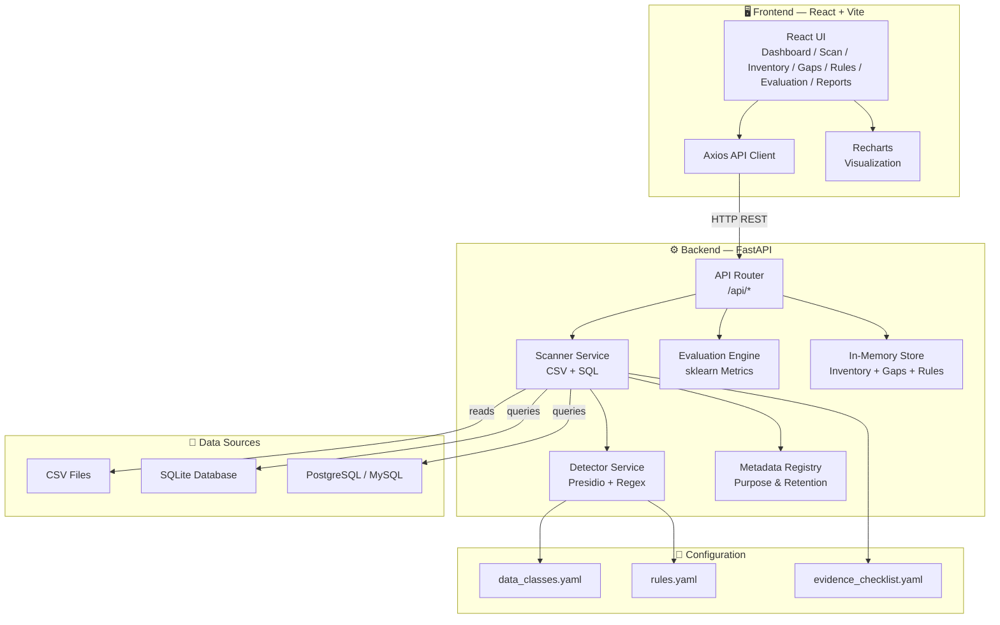
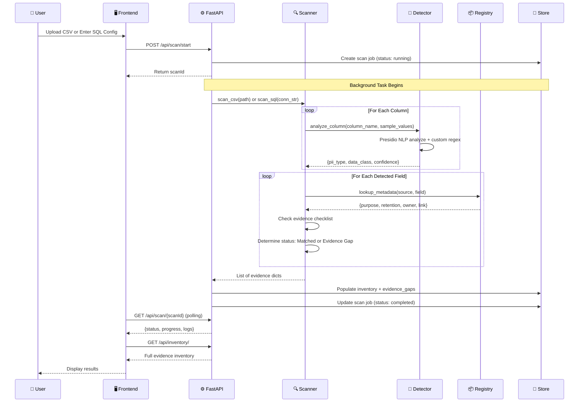
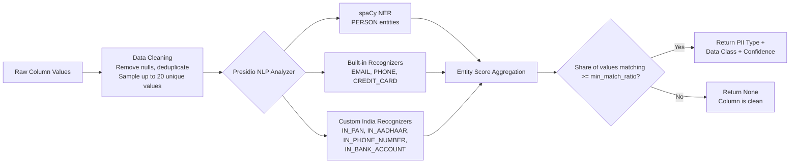
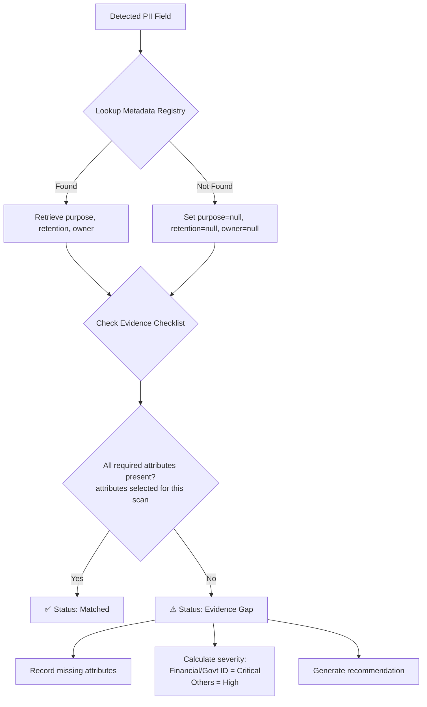
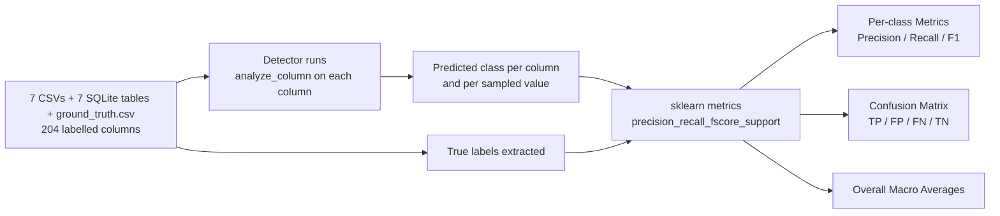
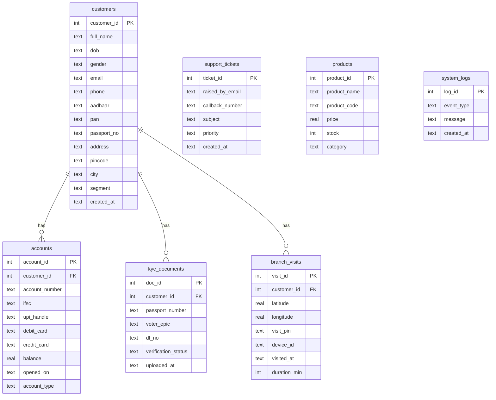

 


<p align="center">
  
  
</p>

<h1 align="center">🛡️ PriVista</h1>
<h3 align="center"><em>Personal-Data Discovery & Privacy Evidence Inventory</em></h3>

<p align="center">
  An intelligent scanner that discovers Personally Identifiable Information (PII) across CSV files and SQL databases, links each discovered field to declared business purposes and retention schedules, and produces a structured evidence inventory for human review — flagging every gap where metadata is missing.
</p>
<div align="center">

[](https://reactjs.org/)
[](https://fastapi.tiangolo.com/)
[](https://python.org/)
[](https://microsoft.github.io/presidio/)
[](https://tailwindcss.com/)
[](#)

</div>

---
<b>Watch the complete walkthrough of PriVista on YouTube:</b> <a href="https://youtu.be/I59mDbrqpyo"></a>


<b>Explore the live PriVista web application:</b> <a href="https://privista-2-0.vercel.app/"></a>


## 📑 Table of Contents

| # | Section |
|---|---------|
| 1 | [Problem Statement](#-problem-statement) |
| 2 | [Our Solution — PriVista](#-our-solution--privista) |
| 3 | [Key Features](#-key-features) |
| 4 | [System Architecture](#-system-architecture) |
| 5 | [Tech Stack](#-tech-stack) |
| 6 | [Project Structure](#-project-structure) |
| 7 | [Core Workflow — How a Scan Works](#-core-workflow--how-a-scan-works) |
| 8 | [Detection Pipeline — Deep Dive](#-detection-pipeline--deep-dive) |
| 9 | [The 5 Personal-Data Classes](#-the-5-personal-data-classes) |
| 10 | [Evidence Inventory & Gap Analysis](#-evidence-inventory--gap-analysis) |
| 11 | [Evaluation Engine](#-evaluation-engine) |
| 12 | [Configurable Detection Rules](#-configurable-detection-rules) |
| 13 | [API Reference](#-api-reference) |
| 14 | [Frontend Pages](#-frontend-pages) |
| 15 | [Getting Started](#-getting-started) |
| 16 | [Data Files & Seed Scripts](#-data-files--seed-scripts) |

---

## 🔍 Problem Statement

> **PS-019 · Personal-Data Discovery and Privacy Evidence Inventory**
> *(Category: Cybersecurity — AIORI-3)*

Modern data-protection frameworks require organizations to **identify stored Personally Identifiable Information (PII)** and link it to **declared purposes and retention schedules**. Over time, personal-data fields accumulate across unindexed database tables and spreadsheets without clear documentation.

### The Challenge

Build a tool that:

1. **Identifies** candidate personal-data fields in synthetic structured datasets (CSV + SQL).
2. **Connects** them with declared purposes and retention metadata.
3. **Creates** a privacy evidence inventory for human review — *without* making legal compliance decisions.

### Key Requirements

| # | Requirement | How PriVista Addresses It |
|---|-------------|--------------------------|
| 1 | Support CSV and one SQL database | ✅ CSV upload + SQLite / PostgreSQL / MySQL scanning |
| 2 | Identify 5 predefined data classes | ✅ Personal identity, Contact information, Government identifiers, Financial information, Location / address (anything else = "Not personal data") |
| 3 | Use a small manually labelled test set for evaluation | ✅ 7 CSVs + 7 SQLite tables from a seeded generator, 204 fields labelled in `ground_truth.csv` (21-22 per class + 97 negatives) |
| 4 | Detect candidate personal-data fields using configurable rules | ✅ YAML-driven rules + Presidio NLP + custom regex |
| 5 | Link discovered fields to purpose and retention metadata | ✅ Metadata Registry with automated lookups |
| 6 | Flag missing purpose or retention information | ✅ Evidence Gap tracker with severity ratings |
| 7 | Report per-class precision and recall | ✅ Evaluation engine with sklearn metrics |
| 8 | Clearly distinguish technical evidence from legal interpretation | ✅ Reports labelled as "Technical Evidence" only |
| 9 | No automatic lawful-basis determination or universal data-flow inference | ✅ System produces evidence for human review only |

### Expected Outcomes Delivered

- ✅ **Personal-data discovery scanner** — scans CSV files and SQL databases
- ✅ **Structured data inventory** — browsable, searchable evidence table
- ✅ **Configurable evidence checklist** — `evidence_checklist.yaml` (purpose, retention, owner), selectable per scan
- ✅ **Purpose and retention metadata mapping** — automatic via Metadata Registry
- ✅ **Per-class precision/recall evaluation** — built-in evaluation page
- ✅ **Missing-metadata and evidence gap report** — dedicated Evidence Gaps view
- ✅ **Final technical report and demonstration** — downloadable JSON reports

---

## 💡 Our Solution — PriVista

**PriVista** (_Privacy + Vista_) is a full-stack web application that automates personal-data discovery and produces a structured privacy evidence inventory.

```
┌───────────────────────────────────────────────────────────────────────┐
│                                                                       │
│   📄 CSV Files   ──┐                                                  │
│                     ├──►  🤖 PII Detection Engine  ──►  📋 Evidence   │
│   🗄️ SQL Database ──┘     (Presidio NLP + Regex)       Inventory     │
│                                                            │          │
│                                                            ▼          │
│                                                    ┌──────────────┐   │
│                                                    │  ✅ Matched   │   │
│                                                    │  ⚠️ Gaps      │   │
│                                                    │  📊 Reports   │   │
│                                                    └──────────────┘   │
│                                                                       │
└───────────────────────────────────────────────────────────────────────┘
```

The system **does not** make legal compliance decisions — it produces **technical evidence** for human reviewers to evaluate.

---

## ✨ Key Features

| Feature | Description |
|---------|-------------|
| **🔎 Multi-Source Scanning** | Upload CSV files or connect directly to SQLite, PostgreSQL, or MySQL databases |
| **🤖 NLP + Regex Detection** | Microsoft Presidio NLP engine with spaCy NER models, enhanced by custom India-specific regex patterns |
| **📦 5 Personal-Data Classes** | Personal identity, Contact information, Government identifiers, Financial information, Location / address |
| **📋 Evidence Inventory** | Structured, searchable table of every discovered PII field with metadata |
| **⚠️ Gap Analysis** | Automatically flags fields missing purpose, retention, or owner metadata |
| **⚙️ Configurable Rules** | YAML-driven detection rules with live toggle and real-time test console |
| **📊 Evaluation Metrics** | Per-class precision, recall, F1-score with confusion matrix visualization |
| **📥 Downloadable Reports** | Export evidence inventory, gap register, and rule config as JSON |
| **🎨 Modern Dashboard** | Real-time charts, trend analysis, and compliance score overview |

---

## 🏗️ System Architecture



### Layered Architecture Overview

```
┌─────────────────────────────────────────────────────┐
│               PRESENTATION LAYER                     │
│   React 19 + Vite 8 + TailwindCSS 4 + Recharts     │
│   Pages: Dashboard │ Scan │ Inventory │ Gaps │      │
│          Rules │ Evaluation │ Reports                │
├─────────────────────────────────────────────────────┤
│                  API LAYER                           │
│   Axios HTTP Client ←──REST──→ FastAPI Router       │
│   Error banners when the backend is unreachable      │
├─────────────────────────────────────────────────────┤
│               SERVICE LAYER                          │
│   Scanner → Detector → Registry → Evaluator         │
│   Background Scan Jobs with Progress Tracking        │
├─────────────────────────────────────────────────────┤
│            CONFIGURATION LAYER                       │
│   data_classes.yaml │ rules.yaml │ checklist.yaml   │
├─────────────────────────────────────────────────────┤
│                DATA LAYER                            │
│   CSV Files │ SQLite │ PostgreSQL │ MySQL            │
│   In-Memory Store (Inventory, Gaps, Rules, Reports) │
└─────────────────────────────────────────────────────┘
```

---

## 🛠️ Tech Stack

### Backend

| Technology | Version | Purpose |
|------------|---------|---------|
| **Python** | 3.10+ | Core backend language |
| **FastAPI** | Latest | Async REST API framework with auto-generated OpenAPI docs |
| **Uvicorn** | Latest | ASGI server for running FastAPI |
| **Microsoft Presidio** | Latest | NLP-powered PII detection engine |
| **spaCy** (`en_core_web_lg`) | Latest | Named Entity Recognition (NER) model for detecting names, orgs, etc. |
| **SQLAlchemy** | Latest | SQL database ORM — connection, introspection, and querying |
| **Pandas** | Latest | CSV parsing and tabular data manipulation |
| **scikit-learn** | Latest | Precision, recall, F1 computation for evaluation metrics |
| **NumPy** | Latest | Numerical operations for metric calculations |
| **PyYAML** | Latest | YAML configuration file parsing |
| **Pydantic** | Latest | Request/response schema validation |
| **Faker** | Latest | Synthetic test-data generation (Indian locale) |

### Frontend

| Technology | Version | Purpose |
|------------|---------|---------|
| **React** | 19.2 | Component-based UI framework |
| **Vite** | 8.3 | Lightning-fast dev server and build tool |
| **TailwindCSS** | 4.3 | Utility-first CSS framework |
| **React Router DOM** | 7.18 | Client-side routing and navigation |
| **Axios** | 1.20 | HTTP client for API communication |
| **Recharts** | 3.10 | Charting library for pie charts, line charts, bar charts |
| **Lucide React** | 1.59 | Modern icon library |
| **OxLint** | 1.81 | Fast JavaScript linter |

### Data Storage & Formats

| Component | Technology |
|-----------|------------|
| **Primary SQL Database** | SQLite (bundled `sample.db`) |
| **External Database Support** | PostgreSQL, MySQL |
| **File Input** | CSV (`.csv`) |
| **Configuration** | YAML (`.yaml`) |
| **Test Data** | 7 CSVs + 7 SQLite tables, 204 fields labelled in `ground_truth.csv` |
| **Reports** | JSON export |

### NLP & Detection Stack

| Component | Technology |
|-----------|------------|
| **NLP Engine** | Microsoft Presidio Analyzer |
| **NER Model** | spaCy `en_core_web_lg` (English — large) |
| **Custom Recognizers** | Regex rules for Indian identifiers (Aadhaar, PAN, passport, voter ID, driving licence, phone, bank account, IFSC, UPI, PIN code), date of birth, gender, age, address, coordinates |
| **Context Boosting** | Column-name context words boost confidence scores |
| **Checksum / Structure Checks** | Verhoeff (Aadhaar), Luhn (cards), PAN holder type, licence state code and year, date / age / coordinate ranges |
| **Nested-match rule** | A match inside a longer match of another class is dropped (a name inside an address, digits before `@` in a UPI ID) |

---

## 📂 Project Structure

```
PriVista/
├── backend/
│   ├── app/
│   │   ├── main.py                    # FastAPI app entry point
│   │   ├── api/
│   │   │   └── routes.py              # All REST API endpoints (363 lines)
│   │   ├── core/
│   │   │   └── config.py              # YAML config loader
│   │   ├── models/
│   │   │   └── schemas.py             # Pydantic request/response models
│   │   └── services/
│   │       ├── scanner.py             # CSV + SQL scanning logic
│   │       ├── detector.py            # Presidio NLP + custom regex detection
│   │       ├── registry.py            # Purpose & retention metadata registry
│   │       ├── evaluation.py          # Precision/recall/F1 computation
│   │       └── store.py               # In-memory data store (inventory, gaps, rules)
│   ├── config/
│   │   ├── data_classes.yaml          # The 5 organizer-defined classes, sub-types, handling tier
│   │   ├── rules.yaml                 # Custom regex recognizers for Indian PII
│   │   └── evidence_checklist.yaml    # Required evidence attributes
│   ├── data/
│   │   ├── synthetic/                 # 7 generated evaluation CSVs
│   │   ├── sample.db                  # Generated SQLite database (7 tables)
│   │   ├── sample_dump.sql            # SQL dump of sample.db
│   │   ├── ground_truth.csv           # Labels: dataset,column,true_class,sub_type,...
│   │   └── uploads/                   # Uploaded CSV files (runtime)
│   ├── scripts/
│   │   └── generate_datasets.py       # Seeded generator: CSVs, SQLite DB, ground truth, registry
│   └── requirements.txt               # Python dependencies
│
└── frontend/
    ├── index.html                     # HTML entry point
    ├── package.json                   # Node.js dependencies
    ├── vite.config.js                 # Vite + TailwindCSS + React config
    └── src/
        ├── main.jsx                   # React DOM render entry
        ├── App.jsx                    # Root component with routing
        ├── index.css                  # Global TailwindCSS imports
        ├── services/
        │   └── api.js                 # Axios API client
        ├── components/
        │   ├── layout/
        │   │   ├── Sidebar.jsx        # Navigation sidebar
        │   │   └── Topbar.jsx         # Top navigation bar
        │   └── common/
        │       └── MetadataModal.jsx  # Reusable metadata edit modal
        └── pages/
            ├── Dashboard.jsx          # Overview with charts and KPIs
            ├── NewScan.jsx            # CSV upload + SQL connection wizard
            ├── Inventory.jsx          # Full evidence inventory table
            ├── EvidenceGaps.jsx       # Missing metadata gap tracker
            ├── DetectionRules.jsx     # Rule management + test console
            ├── Evaluation.jsx         # Precision/recall/F1 metrics
            └── Reports.jsx            # Report listing and download
```

---

## ⚙️ Core Workflow — How a Scan Works

The following diagram shows the end-to-end flow from data ingestion to evidence inventory:



### Step-by-Step Breakdown

| Step | Action | Component |
|------|--------|-----------|
| **1** | User uploads a CSV file or provides SQL connection details | `NewScan.jsx` |
| **2** | Frontend sends `POST /api/scan/start` with source config | `api.js` |
| **3** | Backend creates a background scan job and returns `scanId` | `routes.py` |
| **4** | Scanner reads all columns from the data source | `scanner.py` |
| **5** | For each column, the Detector analyzes sample values using NLP + regex | `detector.py` |
| **6** | Detected PII fields are mapped to one of the 5 data classes | `detector.py` |
| **7** | The Registry looks up purpose and retention metadata for each field | `registry.py` |
| **8** | Missing metadata attributes are identified via the evidence checklist | `scanner.py` |
| **9** | Each field is classified as **Matched** (complete) or **Evidence Gap** (incomplete) | `scanner.py` |
| **10** | Results populate the in-memory inventory and gap stores | `store.py` |
| **11** | Frontend polls scan progress and displays results when complete | `NewScan.jsx` |

---

## 🔬 Detection Pipeline — Deep Dive



### How Detection Works

1. **Value Sampling**: For each column, up to 20 unique non-null values are sampled.

2. **NLP Analysis**: Each value is analyzed by Microsoft Presidio, which combines:
   - **spaCy NER** — detects named entities like `PERSON`
   - **Built-in recognizers** — detects `EMAIL_ADDRESS`, `PHONE_NUMBER`, `CREDIT_CARD`
   - **Custom recognizers** (from `rules.yaml`) — detects India-specific patterns:
     - `IN_PAN` — PAN card: `[A-Z]{5}[0-9]{4}[A-Z]{1}`
     - `IN_AADHAAR` — Aadhaar: `[2-9]{1}[0-9]{3}\s[0-9]{4}\s[0-9]{4}`
     - `IN_PHONE_NUMBER` — Indian mobile: `(\+91[\-\s]?)?[0]?(91)?[789]\d{9}`
     - `IN_BANK_ACCOUNT` — Bank account: `\b[0-9]{9,18}\b`

3. **Context Boosting**: The column name is passed as context to Presidio. If a column named `pan_card` contains `ABCDE1234F`, the confidence score is **boosted** because the word "pan" matches the context keywords.

4. **Threshold**: Only results with a confidence score ≥ **0.50** are accepted.

5. **Class Mapping**: The Presidio entity type is mapped to one of the 5 data classes using `data_classes.yaml`.

---

## 📊 The 5 Personal-Data Classes

The classes and their sub-types are the ones defined by the PS-019 organizers. Anything that matches none of them is labelled **Not personal data**.

| Data Class | Sub-type | Rule / entity | Detection method | Needs column context? |
|------------|----------|---------------|------------------|-----------------------|
| **Personal identity** (High) | Name | `PERSON` | spaCy NER + plausibility check | No |
| | Date of birth | `DATE_OF_BIRTH` | Date regex + real past date (1900 to today) | Yes (`dob`, `birth`) |
| | Gender | `GENDER` | Fixed word list (male, female, transgender…) | Only for `M` / `F` |
| | Age | `AGE` | Whole number 0-120 | Yes (`age`) |
| **Contact information** (Medium) | Email address | `EMAIL_ADDRESS` | Presidio + TLD validation | No |
| | Phone number | `IN_PHONE_NUMBER`, `PHONE_NUMBER` | Indian mobile regex, libphonenumber | No |
| **Government identifiers** (Critical) | Aadhaar | `IN_AADHAAR` | Regex + Verhoeff checksum | Only for ungrouped 12 digits |
| | PAN | `IN_PAN` | Regex + holder-type letter check | No |
| | Passport | `IN_PASSPORT` | Regex (letter + 7 digits), no checksum | Yes (`passport`) |
| | Voter ID (EPIC) | `IN_VOTER_ID` | Regex (3 letters + 7 digits), no checksum | No |
| | Driving licence | `IN_DRIVING_LICENCE` | Regex + state-code and issue-year check | No |
| **Financial information** (Critical) | Card number | `CREDIT_CARD`, `IN_RUPAY_CARD`, `MASKED_CARD` | Presidio / regex + Luhn checksum | No |
| | Bank account | `IN_BANK_ACCOUNT` | 9-18 digits | Yes (`account`, `acct`) |
| | IFSC | `IN_IFSC` | Regex (4 letters + `0` + 6 characters) | No |
| | UPI ID | `UPI_ID` | `name@handle` with no dot after `@`; known bank handles score higher | Only for unknown handles |
| **Location / address** (High) | Postal address | `POSTAL_ADDRESS` | Address words + house number/PIN + 3+ words | No |
| | PIN code | `IN_PIN_CODE` | 6 digits, first digit 1-9 | Yes (`pin`, `pincode`, `postal`) |
| | Geo-coordinates | `GEO_COORDINATES` | `lat, lon` pair + range check | Only for a single lat or lon value |

**Why some sub-types need column context.** A value such as `34`, `560001`, `M` or `2024-01-15` cannot be told apart from a quantity, a product code, a T-shirt size or an order date by its value alone. Those rules use a weak base score (0.3) that only reaches the 0.5 threshold when the column name contains a context word, and `negative_column_keywords` switch them off for look-alike columns (`created_at`, `otp`, `size`, `price`).

**Email vs UPI ID.** An email always has a dot in the domain (`@gmail.com`); a UPI ID does not (`@okaxis`). The two rules therefore never match the same value.

**No checksum.** Passport, voter ID and driving licence numbers have no public check digit, so their precision depends on format, validators and column context.

---

## 📋 Evidence Inventory & Gap Analysis

### How Evidence Status is Determined



### The Evidence Checklist

Defined in `evidence_checklist.yaml`, every discovered PII field must have these 3 attributes:

| Required Attribute | Description |
|--------------------|-------------|
| **purpose** | The declared business purpose for storing this data (e.g., "Identity Verification") |
| **retention** | How long the data will be retained (e.g., "7 Years statutory") |
| **owner** | Team accountable for the field (e.g., "Compliance & Risk"). Optional by default |

Each scan can select which attributes are required (New Scan, step 3). The selection is stored on every record, so later edits are re-checked against the same checklist.

### The Metadata Registry

`config/metadata_registry.yaml` holds declared metadata, matched by exact `(source, field)`:

```yaml
declarations:
  - source: sample.customers        # SQL: <sqlite file stem>.<table>
    field: full_name
    purpose: Identity verification (KYC)
    retention: 8 years after account closure
    owner: Compliance & Risk
  - source: customers_kyc.csv       # CSV: file name
    field: driving_licence
    purpose: Identity verification (KYC)   # no retention -> evidence gap
    owner: Compliance & Risk
deliberate_gaps:                    # informational list written by the generator
  - source: customers_kyc.csv
    field: passport_no
    missing: purpose, retention (no declaration)
```

**Metadata format (YAML).** Each entry in `declarations` has `source`, `field`, and optionally `purpose`, `retention` and `owner` (free text). A missing key means that attribute was not declared. `deliberate_gaps` is ignored by the app; it documents which personal-data fields the generator left incomplete on purpose. The file is written by `scripts/generate_datasets.py`, so change the dataset spec there and re-run the script instead of editing it by hand.

**Deliberate gaps.** 38 personal-data fields have missing metadata so the gap report can be demonstrated: all 17 personal-data columns of `vague_columns.csv` (an undocumented export), plus 21 fields spread over every class in the other sources, e.g. `customers_kyc.csv` → `passport_no` (undeclared), `driving_licence` (no retention), `permanent_address` (no purpose), and `sample.accounts.account_number`, `sample.branch_visits.latitude/longitude` (undeclared).

The registry never infers metadata from field names. An undeclared field stays undeclared and becomes an **Evidence Gap**. Metadata a reviewer adds in the UI is saved to `data/declared_metadata.json` and layered on top. Each record shows how its metadata was linked (`Declared in metadata registry`, `Declared by reviewer`, or `No declaration found`).

---

## 📈 Evaluation Engine

The evaluation engine measures how well the detection pipeline classifies personal data on the labelled synthetic datasets: 7 CSV files and the 7 tables of `data/sample.db`. The answer key is `data/ground_truth.csv`, which gives the true class (and sub-type) of every column.

### Evaluation Set Size

| | Labelled fields (columns) | Sampled values |
|---|---|---|
| Personal identity | 21 | 499 |
| Contact information | 21 | 630 |
| Government identifiers | 22 | 660 |
| Financial information | 22 | 660 |
| Location / address | 21 | 630 |
| Not personal data (negatives, incl. look-alikes) | 97 | 2,174 |
| **Total** | **204** (149 CSV + 55 SQL) | **5,253** |

Every class has at least 20 labelled fields, spread over its sub-types, with a comparable number of negatives, following the organizers' recommendation.

### How It Works



### Metrics Computed

| Metric | Formula | Description |
|--------|---------|-------------|
| **Precision** | TP / (TP + FP) | What % of detected PII is actually PII? |
| **Recall** | TP / (TP + FN) | What % of actual PII was detected? |
| **F1-Score** | 2 × (P × R) / (P + R) | Harmonic mean of precision and recall |
| **Personal vs not personal matrix** | TP, FP, FN, TN | Each sampled value counted once (5,253 total) |
| **Class confusion matrix** | 6×6 | True class vs predicted class, including Not personal data |

Each labelled column is scanned once, with the same code path as the scanner (up to 30 unique values sampled per column):

- **Column level:** the column's predicted class against its true class (204 columns), with per-class precision and recall.
- **Value level:** every sampled value against its column's true class (5,253 values). A value's prediction is the class it would get if scanned on its own under that column name. This feeds the score cards, per-class chart and confusion matrices.

Micro and macro averages are reported over the 5 classes. Values in "Not personal data" columns are negatives. Results are cached and recomputed whenever a rule changes (or via **Re-run Evaluation**). Each dataset's score is also shown separately.

### Current Results (default rules, seed 42)

| Class | Column P | Column R | Value P | Value R | Value F1 |
|-------|---------:|---------:|--------:|--------:|---------:|
| Personal identity | 100% | 95.2% | 99.8% | 93.0% | 96.3% |
| Contact information | 100% | 100% | 99.7% | 100% | 99.8% |
| Government identifiers | 100% | 100% | 100% | 100% | 100% |
| Financial information | 100% | 95.5% | 100% | 95.0% | 97.4% |
| Location / address | 100% | 100% | 100% | 100% | 100% |
| **Micro average** | **100%** | **98.1%** | **99.9%** | **97.8%** | **98.8%** |

Column-level accuracy is 202/204. No negative column is reported as personal data. The two misses are deliberate hard cases in `vague_columns.csv`: `col_s` holds dates of birth and `col_t` holds bank account numbers under names that give no hint. A bare date or a 9-18 digit number cannot be told apart from an order date or a reference number without column context. At value level, spaCy also misses a few names, unknown UPI handles (`@payzapp`) are not reported without a `upi` column name, and one `Other` value in a vague gender column is missed.

These numbers come from synthetic data written by the same team that wrote the rules. Treat them as a regression check, not as an estimate of accuracy on real databases.

### Test Datasets

All datasets are generated by `scripts/generate_datasets.py` (seed 42, 60 rows per table, 40 for `products`). Each personal-data class appears in clear column names (`passport_no`), prefixed names (`payer_pan`) and vague names (`col_e`), in several value formats.

| Dataset | Fields | What it covers |
|---------|-------:|----------------|
| `synthetic/customers_kyc.csv` | 20 | KYC record: name, DOB (dd/mm/yyyy), gender, age, emails, mobile, all five government IDs, two addresses, PIN |
| `synthetic/payments.csv` | 20 | Payer details, Visa/Mastercard, RuPay and masked cards, bank accounts, IFSC, UPI IDs; look-alikes: phone-like `order_id`, Aadhaar-like `invoice_no` |
| `synthetic/delivery_orders.csv` | 17 | Recipient, phones, shipping/pickup addresses, spaced PIN codes, lat/lon pairs, COD UPI; look-alikes: IFSC-like `warehouse_code`, PAN-like `sku`, 6-digit `otp` |
| `synthetic/hr_employees.csv` | 23 | DOB (yyyy-mm-dd), `M`/`F` sex, ungrouped Aadhaar, passport, licence, voter card, salary account/IFSC; look-alike `rating` |
| `synthetic/patients.csv` | 19 | DOB (`12 Mar 1990`), guardian details, GPS location; `blood_group` (sensitive but outside the five classes) |
| `synthetic/vague_columns.csv` | 22 | Personal data under names `col_a`…`col_w`, so detection must rely on values; no metadata declared |
| `synthetic/lookalikes.csv` | 28 | Negatives only: values shaped like phones, Aadhaar, PAN, cards, voter IDs, passports, licences, UPI IDs, PINs, coordinates, ages, dates, plus GSTIN, IP/MAC address, vehicle registration, ISBN, PNR |
| `sample.db:customers` | 14 | Customer master with DOB, gender, IDs, address, PIN |
| `sample.db:accounts` | 10 | Account number, IFSC, UPI handle, debit/credit card; look-alikes `account_id`, `account_type` |
| `sample.db:kyc_documents` | 7 | Passport, voter EPIC, licence numbers |
| `sample.db:branch_visits` | 8 | Separate `latitude` / `longitude` (REAL) and PIN |
| `sample.db:support_tickets` | 6 | Contact email and callback number |
| `sample.db:products` | 6 | Negatives only, incl. PAN-like `product_code` and `product_name` |
| `sample.db:system_logs` | 4 | Negatives only |

`ground_truth.csv` columns: `dataset` (CSV path under `data/`, or `<sqlite file>:<table>`), `column`, `true_class`, `sub_type`, `source_type`, `notes` (marks look-alikes and hard cases). Only the first three are used for scoring.

To change the evaluation set, edit the `TABLES` spec in `scripts/generate_datasets.py` and re-run it. It rewrites the datasets, the ground truth and the metadata registry together, so they stay consistent.

---

## ⚙️ Configurable Detection Rules

`config/rules.yaml` is the single source of truth. The scanner, the evaluation and the UI all use the same rules. Every rule maps to exactly one of the 5 classes, and only entities of **enabled** rules are analysed. Presidio's broad built-in `DATE_TIME` and `LOCATION` recognizers are not used; dates count only as date of birth and places only as addresses, PIN codes or coordinates, through the narrower rules below.

```yaml
settings:
  sample_size: 30          # unique values sampled per column
  min_match_ratio: 0.3     # share of sampled values that must match
  column_name_hints: true  # low-confidence candidate if only the column name matches

rules:
  - id: IN_AADHAAR
    entity: IN_AADHAAR
    data_class: Government identifiers
    engine: regex                # regex | presidio (built-in recognizer)
    patterns:
      - { name: aadhaar_grouped, regex: "\\b[2-9][0-9]{3}[\\s-][0-9]{4}[\\s-][0-9]{4}\\b", score: 0.85 }
      - { name: aadhaar_plain,   regex: "\\b[2-9][0-9]{11}\\b", score: 0.3 }   # needs column context
    context: [aadhaar, aadhar, uidai, uid]
    column_keywords: [aadhaar, aadhar, uidai]
    min_score: 0.5
    enabled: true
```

| Rule | Entity | Class | Method |
|------|--------|-------|--------|
| Person Name | `PERSON` | Personal identity | spaCy NER + plausibility check (no digits / masks) |
| Date of Birth | `DATE_OF_BIRTH` | Personal identity | Date regex + past-date validator, needs column context |
| Gender | `GENDER` | Personal identity | Word list; `M`/`F` need column context |
| Age | `AGE` | Personal identity | 0-120 validator, needs column context |
| Email Address | `EMAIL_ADDRESS` | Contact information | Presidio + TLD validation |
| Indian Mobile Number | `IN_PHONE_NUMBER` | Contact information | Regex (+91/0, 6-9 start, 5-5 / 3-3-4 grouping) |
| International Phone | `PHONE_NUMBER` | Contact information | Presidio + libphonenumber |
| Aadhaar Number | `IN_AADHAAR` | Government identifiers | Regex (4-4-4) + Verhoeff checksum + context |
| PAN Card Number | `IN_PAN` | Government identifiers | Regex + holder-type letter validator |
| Indian Passport | `IN_PASSPORT` | Government identifiers | Regex, needs column context |
| Voter ID (EPIC) | `IN_VOTER_ID` | Government identifiers | Regex (AAA9999999) |
| Driving Licence | `IN_DRIVING_LICENCE` | Government identifiers | Regex + state-code / issue-year validator |
| Credit / Debit Card | `CREDIT_CARD` | Financial information | Presidio + Luhn checksum |
| RuPay Card Number | `IN_RUPAY_CARD` | Financial information | Regex (60/65/81/82/508) + Luhn checksum |
| Masked Card Number | `MASKED_CARD` | Financial information | Regex (`XXXX-XXXX-XXXX-1234`) |
| Bank Account Number | `IN_BANK_ACCOUNT` | Financial information | Weak regex, needs column context |
| IFSC Code | `IN_IFSC` | Financial information | Regex (AAAA0XXXXXX) |
| UPI ID | `UPI_ID` | Financial information | `name@handle` (no dot), known-handle list |
| Postal Address | `POSTAL_ADDRESS` | Location / address | Address words + number + address validator |
| PIN Code | `IN_PIN_CODE` | Location / address | 6-digit regex, needs column context |
| Geo-coordinates | `GEO_COORDINATES` | Location / address | `lat, lon` regex + range validator |

**Negative column keywords.** A rule can list `negative_column_keywords`. When the column name contains one, that rule is skipped for the column, so a phone-shaped `order_id`, a PAN-shaped `sku` or a `plan_name` column is not reported as personal data.

**Column decision.** A column gets the class whose rules match the largest share of sampled values (ratio × mean score), provided at least `min_match_ratio` of the values match. Each finding records the rule, values matched / sampled, mean confidence, whether a column-name context boost applied, and **masked** sample values. Raw values are never stored.

**In the UI** you can toggle rules, add custom regex rules (validated, persisted in `data/rules_state.json`), delete custom rules, and run the real detector on any text in the Rule Sandbox, optionally with a simulated column name for context.

---

## 🌐 API Reference

### Scan Endpoints

| Method | Endpoint | Description |
|--------|----------|-------------|
| `POST` | `/api/scan/upload` | Upload a CSV (max 50 MB, validated); returns `uploadId` |
| `POST` | `/api/scan/upload-sqlite` | Upload a SQLite file (`.db` / `.sqlite` / `.sqlite3`, max 50 MB, header checked); returns `uploadId` and table names. Scanned read-only |
| `POST` | `/api/scan/test-connection` | Test SQLite / PostgreSQL / MySQL connectivity; lists tables |
| `POST` | `/api/scan/start` | Start a background scan (`sourceType`: `csv`, `sqlite` (uploaded file) or `sql`, `checklist`) |
| `GET` | `/api/scan/{scanId}` | Poll status, progress, real per-table/column logs, summary |
| `GET` | `/api/scan/{scanId}/results` | Records produced by that scan |
| `GET` | `/api/scan/history` | Recent scans (feeds the dashboard trend and notifications) |
| `POST` | `/api/scan/csv`, `/api/scan/sql` | Synchronous scans for scripting |

### Inventory & Evidence Gaps

| Method | Endpoint | Description |
|--------|----------|-------------|
| `GET` | `/api/inventory/` | All scanned fields with detection evidence and metadata |
| `PATCH` | `/api/inventory/{id}` | Set `purpose` / `retention` / `owner` / `sensitivity`, or `review_decision` (`confirmed`, `non_pii`, `reset`) |
| `DELETE` | `/api/inventory/{id}` | Delete a record ("Not personal data" only; personal-data evidence returns 403) |
| `POST` | `/api/inventory/reset?confirm=true` | Clear inventory and scan history |
| `GET` | `/api/evidence-gaps/` | Gaps derived live from the inventory, sorted by severity |
| `POST` | `/api/evidence-gaps/{gapId}/resolve` | Add missing metadata (also saved as a reviewer declaration) |

### Rules, Config & Evaluation

| Method | Endpoint | Description |
|--------|----------|-------------|
| `GET` / `POST` | `/api/rules/` | List rules / create a validated custom regex rule |
| `POST` | `/api/rules/{id}/toggle` | Enable or disable a rule (affects scans and evaluation) |
| `DELETE` | `/api/rules/{id}` | Delete a custom rule (built-in rules: 403) |
| `POST` | `/api/rules/test` | Run the real detector on sandbox text |
| `GET` | `/api/config/checklist`, `/api/config/data-classes` | Checklist attributes and the 5 classes |
| `GET` | `/api/evaluation/?refresh=false` | Cached value-level and column-level evaluation |
| `POST` | `/api/evaluate` | Metrics for arbitrary `true_labels` / `predicted_labels` |

### Dashboard & Reports

| Method | Endpoint | Description |
|--------|----------|-------------|
| `GET` | `/api/dashboard/summary` | KPIs computed from the inventory (personal data only, "Not personal data" excluded) |
| `GET` | `/api/dashboard/charts` | PII by class, plus inventory/gap totals after each scan |
| `GET` | `/api/reports/` | Report catalog with live scores |
| `GET` | `/api/reports/{id}/download?format=pdf\|json` | `evidence_manifest` (final technical report), `rep-001`…`rep-004` |

---

## 🎨 Frontend Pages

| Page | Route | Description |
|------|-------|-------------|
| **Dashboard** | `/` | KPI cards, PII distribution pie chart, discovery trend line chart, recent gaps table |
| **New Scan** | `/scan` | CSV upload (drag & drop) + SQL connection wizard with live test |
| **Inventory** | `/inventory` | Searchable, filterable evidence inventory table with inline editing |
| **Evidence Gaps** | `/gaps` | Gap tracker with severity badges and resolve workflow |
| **Detection Rules** | `/rules` | Rule listing with enable/disable toggles, create new rules, test console |
| **Evaluation** | `/evaluation` | Precision/recall/F1 metrics, per-class breakdown, confusion matrix |
| **Reports** | `/reports` | Report listing with download functionality |

### UI Components

| Component | File | Purpose |
|-----------|------|---------|
| `Sidebar` | `components/layout/Sidebar.jsx` | Navigation sidebar with route links |
| `Topbar` | `components/layout/Topbar.jsx` | Top bar with search and actions |
| `MetadataModal` | `components/common/MetadataModal.jsx` | Reusable modal for editing field metadata |

---

## 🚀 Getting Started

### Prerequisites

- **Python** 3.10 or higher
- **Node.js** 18 or higher
- **npm** 9 or higher

### 1. Clone the Repository

```bash
git clone https://github.com/your-repo/PriVista.git
cd PriVista
```

### 2. Backend Setup

```bash
cd backend

# Create virtual environment
python -m venv venv

# Activate virtual environment
# Windows:
venv\Scripts\activate
# macOS/Linux:
source venv/bin/activate

# Install dependencies
pip install -r requirements.txt

# Download spaCy language model
python -m spacy download en_core_web_lg

# (Optional) Regenerate the synthetic datasets, SQLite database, ground truth and
# metadata registry. The generated files are already committed; with the fixed
# seed the script reproduces them exactly.
python scripts/generate_datasets.py

# Start the backend server
uvicorn app.main:app --reload --port 8000
```

The backend API will be available at `http://localhost:8000`.
Interactive API docs at `http://localhost:8000/docs`.

### 3. Frontend Setup

```bash
cd frontend

# Install dependencies
npm install

# Start the development server
npm run dev
```

The frontend will be available at `http://localhost:5173`.

### 4. Environment Variables

Create a `.env` file in `frontend/`:

```env
VITE_API_URL=http://localhost:8000/api
```

The frontend always talks to the real backend. If the backend is unreachable, every page shows an error banner instead of silently displaying mock data.

### 5. Demo Walkthrough

1. **New Scan → Upload SQLite Database → choose `backend/data/sample.db` → Launch Scan.** 55 fields scanned: 23 personal-data candidates and 8 evidence gaps, e.g. `accounts.account_number` and `branch_visits.latitude` have no declaration, `customers.pan` has no retention, and `support_tickets.callback_number` has no purpose.
2. **New Scan → Upload CSV → `data/synthetic/customers_kyc.csv`.** 3 gaps (`passport_no`, `driving_licence`, `permanent_address`). Enable *Data Owner* in the checklist to see how the configurable checklist creates extra gaps. `vague_columns.csv` shows an export with no metadata at all.
3. **Evidence Gaps → Review & Add Metadata.** The declaration is saved to `data/declared_metadata.json`, so re-scanning the same source links it automatically.
4. **Detection Rules →** disable a rule or add a custom one, then **Evaluation → Re-run** to see the per-class precision/recall change.
5. **Reports → Final Technical Evidence Report (PDF).**

To start over: **Inventory → Reset** (or `POST /api/inventory/reset?confirm=true`).

### Configuration Files

| File | Purpose |
|------|---------|
| `config/rules.yaml` | Detection rules: regex patterns, context words, column keywords, min confidence, enabled flag, sampling settings |
| `config/data_classes.yaml` | The 5 data classes and their handling tier (used for gap severity) |
| `config/evidence_checklist.yaml` | Checklist attributes (purpose, retention, owner) and which are required by default |
| `config/metadata_registry.yaml` | Declared purpose / retention / owner per `(source, field)`. SQL source = `<db>.<table>`, CSV source = file name. Generated by `scripts/generate_datasets.py` |

Runtime state (gitignored): `data/store_state.json` (inventory and scan history), `data/rules_state.json` (rule toggles and custom rules), `data/declared_metadata.json` (reviewer declarations).

> ⚠️ The API has no authentication. It is meant for local use on synthetic data; CORS only allows `http://localhost:5173` by default (override with `PRIVISTA_CORS_ORIGINS`).

---

## 📦 Data Files & Generator

All data is **fully synthetic**. Names and addresses come from Faker (`en_IN` locale), e-mails use the reserved `example.com/.org/.net` domains, and every ID number is random characters in the official format (Aadhaar with a valid Verhoeff digit, cards with a valid Luhn digit, PAN with a valid holder-type letter). No real, scraped or leaked identifiers are used.

| File | Description |
|------|-------------|
| `scripts/generate_datasets.py` | The only generator. Fixed seed (`SEED = 42`); running it twice produces byte-identical files |
| `data/synthetic/*.csv` | 7 evaluation CSVs, UTF-8 with a header row, 60 rows each |
| `data/sample.db` | SQLite database with 7 tables (customers, accounts, kyc_documents, branch_visits, support_tickets, products, system_logs) |
| `data/sample_dump.sql` | Plain-SQL dump of `sample.db` |
| `data/ground_truth.csv` | Manually designed column labels for all 204 fields (see [Test Datasets](#test-datasets)) |
| `config/metadata_registry.yaml` | Declared purpose / retention / owner, with deliberate gaps |

### SQL Engine: SQLite

We use **SQLite** for the bundled database. It needs no server, ships with Python, and the whole database is one committed file, so mentors can reproduce the numbers without any setup. The scanner also connects to PostgreSQL and MySQL through SQLAlchemy (see New Scan).

Setup options:

```bash
cd backend
# Option A: use the committed database as-is (data/sample.db)
# Option B: regenerate everything from the seed
python scripts/generate_datasets.py
# Option C: rebuild the database from the SQL dump
sqlite3 data/sample.db < data/sample_dump.sql
```

### SQLite Database Schema



`customer_id` in the child tables holds random values from 1 to 60. The relationships are illustrative, and the tables do not declare foreign-key constraints.

---

<p align="center">
  <strong>PriVista</strong> — <em>Turning data discovery into privacy evidence, one scan at a time.</em>
</p>
